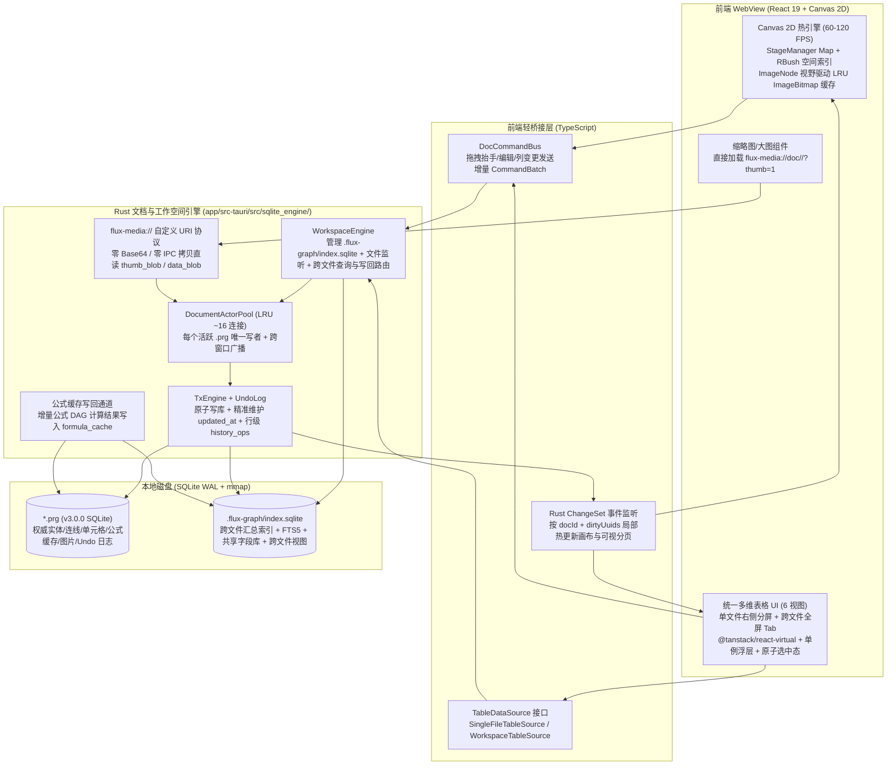

# Flux Graph SQLite v3.0.0 完整重构实施方案与跨会话交接文档

> **文档定位**：本文件是下一阶段重构的**唯一权威施工蓝图**，供后续新会话 Agent 直接接手执行，无需重复调研。  
> **基线版本**：`Flux Graph v5.1.4`（仓库 `D:\Program Files D\flux graph`，`.prg` 当前格式 `2.8.0`）  
> **目标版本**：`.prg` 格式升至 **`3.0.0`**（原生 SQLite 单文件格式）  
> **创建日期**：2026-11-27

---

## 0. 路径基线与操作红线（新会话必读）

| 用途                  | 路径                                                                         | 约束                                                                                                                                  |
| --------------------- | ---------------------------------------------------------------------------- | ------------------------------------------------------------------------------------------------------------------------------------- |
| **源码主仓库（Git）** | `D:\Program Files D\flux graph`                                              | 所有代码改动、单测、Cargo 编译均在此目录                                                                                              |
| **本地桌面测试程序**  | `D:\Program Files D\flux graph\app\src-tauri\target\debug\project-graph.exe` | 必须按 `flux-graph-local-test` 技能使用 `TAURI_CONFIG` 独立标识 `liren.project-graph.dev-test` 编译，配合 `1420` 端口纯前端 Vite 服务 |
| 工作区入口与交接文档  | `d:\Library Files D\antigravity\flux graph`                                  | 仅放交接/规划文档，**非源码目录**                                                                                                     |
| 用户个人脑图数据      | `D:\Library Files D\flux graph`                                              | **严禁修改、严禁当测试数据**                                                                                                          |
| 用户日常正式版        | `D:\Program Files D\flux graph user\project-graph.exe`                       | **严禁误杀进程或覆盖**                                                                                                                |
| 全局测试技能          | `C:\Users\admin\.gemini\config\skills\flux-graph-local-test\SKILL.md`        | 动工、启测、发版前**必读**                                                                                                            |
| 多维表格功能基线      | `d:\Library Files D\antigravity\flux graph\HANDOFF-多维表格.md`              | v5.0.0+ 已拍板产品规则，**绝不回退**                                                                                                  |

---

## 1. 已最终拍板的 5 项产品与架构决策（不可擅自更改）

1. **直接瞄准 SQLite 架构**（采用 **双层 SQLite 拓扑** + 同步重构多维表格前端虚拟化/单例编辑器 + 画布内存热索引）。
2. **纯本地单机使用**：无需妥协网盘同步边车问题，全面启用原生 SQLite `WAL + synchronous=NORMAL + mmap_size`，关闭工程时自动 `PRAGMA wal_checkpoint(TRUNCATE)` 保持磁盘干净单文件。
3. **原生支持跨文件多维表格**：
   - 每个 `.prg` 仍是磁盘上独立、自包含的 SQLite v3.0.0 文件（权威单一事实源）；
   - 工作空间根目录 `.flux-graph/index.sqlite` 维护轻量级跨文件聚合索引、FTS5 全文索引、共享字段库与跨文件视图配置（不含大原图，100 文件/10,000 行实测仅 12 MB，冷重建 435 ms，启动校验 0.78 ms）。
4. **实时自动落盘（Auto-Persist）**：
   - 普通 `.prg` 文件每次操作（画布拖拽松手、改文本、改单元格、间隔重复作答等）在 `< 1 ms` 内直接提交到 SQLite WAL 并增量同步 `index.sqlite`；不再阻塞“未保存更改”关闭弹窗；
   - 撤销/重做改用行级差异日志 `history_ops`（深度 `Ctrl+Z` / `Ctrl+Y`，内存 `< 1 MB`）；
   - `Ctrl+S` 升级为：立即执行 WAL Checkpoint 合并 + 后台通过 SQLite Online Backup API 在 `.flux-graph/history/` 留存一个历史里程碑快照；
   - 临时草稿 (`draft:*`) 使用系统缓存目录临时 SQLite，关闭非空草稿时仍保留“另存为 `.prg`”提示。
5. **一键备份并批量升级至 `.prg v3.0.0`**：
   - `LATEST_PROJECT_VERSION = "3.0.0"`，以文件头魔数区分旧版 ZIP（`PK\x03\x04`）与新版 SQLite（`SQLite format 3\0`）；
   - 打开含旧版 `.prg`（v2.0–v2.8）的工作空间时提示“一键备份并升级到 v3.0”：先完整保留目录结构备份至 `.flux-graph/backup-v2/<timestamp>/`，再逐文件无损转换并校验后原子替换；单独打开工作空间外旧 `.prg` 时同理自动留存 `.v2.bak` 后升级。

---

## 2. 前期实测定位的 4 层根因（必须一并根治）

1. **UI 层 $O(N^2)$ 假死灾难（500 行含关系列单次点击 jsdom 实测 16.8 秒、38,353 DOM 节点）**：
   - `stage-table-panel.tsx` 每次 render 在函数体裸跑 `getRows()` + `evaluateTableFormulas()` + `applyTableFiltersAndSort()`；
   - 关闭状态的 `MultiRelationCell`/`SingleRelationCell` Popover 在 JSX 中仍对全部 $N$ 行急切求值 `allRows.filter(...)` 和 `filteredCandidates.map(...)`（构造约 500 万个临时 VDOM）；
   - 6 个视图均未使用已安装的 `@tanstack/react-virtual`；
   - 画布点击/框选（`StageObject.isSelected` → `scheduleCanvasSelectionSync`）与拖动列宽（每帧 `setColumnWidth`）均触发顶层 `StageTablePanel` 全量重渲染。
2. **全量反射序列化 + 快照历史栈 + 语义指纹全扫 + 多窗口 Shadow Diff**：
   - 5,000 节点下单次单元格编辑 `TimeEfficient` 耗时 **444 ms**（50 步历史占 **690 MB** RAM，默认 150 步超 2 GB）；`MemoryEfficient` 第 15 步 > **5 秒**；
   - `syncSemanticTimestamps()` 每次 `recordStep()` 全图扫描拼串；
   - 多窗口 `LocalDocumentSync` 每次 `stage-commit` 全图序列化 Diff（5,000 节点 **798 ms**）；
   - `undo()` 未调用旧 `ImageNode.dispose()` 导致 `ImageBitmap` 显存泄漏并全图重解码。
3. **`.prg` ZIP+MsgPack 整包重写 + 全量图片驻留内存**：
   - 1,000 节点 + 50 MB 图片（100×500KB）：改 1 个字保存耗时 **644 ms** + 50 MB IPC 拷贝；SQLite WAL 仅 **0.09 ms**；
   - 打开文件即全量解压所有 `Blob` + 全量 `createImageBitmap` + 表格 `URL.createObjectURL` 解码全分辨率原图做 28px 缩略图。
4. **画布底账**：`StageManager.get(uuid)` 退化为线性 `.find()` $O(N)$，`getEntities()`/`getEdges()` 在 120 FPS 渲染帧中反复 `.filter()` 分配新数组。

---

## 3. 整体系统架构图



---

## 4. 完整 SQLite Schema 规范（定稿）

### 4.1 单文件 `.prg` v3.0.0 DDL

启动连接必须执行：

```sql
PRAGMA journal_mode = WAL;
PRAGMA synchronous = NORMAL;
PRAGMA foreign_keys = ON;
PRAGMA temp_store = MEMORY;
PRAGMA cache_size = -32000;
PRAGMA mmap_size = 268435456;
```

核心表结构：

```sql
-- 文档元数据（schema_version='3', format_version='3.0.0', docId, readme, tags_json, references_json, revision）
CREATE TABLE IF NOT EXISTS metadata (
  key   TEXT PRIMARY KEY,
  value TEXT NOT NULL
);

-- 11 类实体统一主表（TextNode/Section/ImageNode/UrlNode/LatexNode/MediaNode/SvgNode/ReferenceBlockNode/ExtensionEntity/ConnectPoint/PenStroke）
-- TextNode <-> Section 同 uuid 升降级仅需 UPDATE kind = 'section' | 'text'
CREATE TABLE IF NOT EXISTS entities (
  uuid                TEXT PRIMARY KEY,
  kind                TEXT NOT NULL,
  parent_section_uuid TEXT,
  text                TEXT NOT NULL DEFAULT '',
  details_json        TEXT NOT NULL DEFAULT '[]',
  details_plain       TEXT NOT NULL DEFAULT '',
  x                   REAL NOT NULL DEFAULT 0,
  y                   REAL NOT NULL DEFAULT 0,
  w                   REAL NOT NULL DEFAULT 100,
  h                   REAL NOT NULL DEFAULT 50,
  props_json          TEXT NOT NULL DEFAULT '{}', -- color/borderStyle/locked/isCollapsed/url/latexSource/attachmentId/scale/isBackground/segments/customData/zOrder 等
  created_at          INTEGER NOT NULL,
  updated_at          INTEGER NOT NULL,
  is_row              INTEGER NOT NULL DEFAULT 1, -- ImageNode/PenStroke/ConnectPoint 为 0，其余为 1
  sort_order          INTEGER NOT NULL DEFAULT 0  -- 保留画布绘制与默认表格行顺序
);
CREATE INDEX IF NOT EXISTS idx_entities_parent     ON entities(parent_section_uuid);
CREATE INDEX IF NOT EXISTS idx_entities_row_order  ON entities(is_row, sort_order);
CREATE INDEX IF NOT EXISTS idx_entities_updated    ON entities(is_row, updated_at DESC);
CREATE INDEX IF NOT EXISTS idx_entities_created    ON entities(is_row, created_at DESC);
CREATE INDEX IF NOT EXISTS idx_entities_kind       ON entities(kind);

-- R-Tree 空间索引（通过整数 rowid 映射到 entities.uuid）
CREATE TABLE IF NOT EXISTS entity_rtree_map (
  rtree_id INTEGER PRIMARY KEY AUTOINCREMENT,
  uuid     TEXT UNIQUE NOT NULL REFERENCES entities(uuid) ON DELETE CASCADE
);
CREATE VIRTUAL TABLE IF NOT EXISTS entities_rtree USING rtree(
  id, min_x, max_x, min_y, max_y
);

-- FTS5 全文检索索引
CREATE VIRTUAL TABLE IF NOT EXISTS entities_fts USING fts5(
  uuid UNINDEXED,
  text,
  details_plain,
  tokenize='unicode61'
);

-- 有向边（LineEdge / ArcEdge / CubicCatmullRomSplineEdge）
CREATE TABLE IF NOT EXISTS edges (
  uuid        TEXT PRIMARY KEY,
  kind        TEXT NOT NULL, -- 'line' | 'arc' | 'cr_spline'
  source_uuid TEXT NOT NULL,
  target_uuid TEXT NOT NULL,
  text        TEXT NOT NULL DEFAULT '',
  props_json  TEXT NOT NULL DEFAULT '{}', -- color/lineType/arrowType/sourceRectangleRate/targetRectangleRate/isBranchCollapsed 等
  sort_order  INTEGER NOT NULL DEFAULT 0
);
CREATE INDEX IF NOT EXISTS idx_edges_source ON edges(source_uuid);
CREATE INDEX IF NOT EXISTS idx_edges_target ON edges(target_uuid);

-- 多目标无向边 & 孪生同步关联（MultiTargetUndirectedEdge / SyncAssociation）
CREATE TABLE IF NOT EXISTS associations (
  uuid              TEXT PRIMARY KEY,
  kind              TEXT NOT NULL, -- 'multi_target' | 'sync'
  member_uuids_json TEXT NOT NULL, -- JSON string[]
  props_json        TEXT NOT NULL DEFAULT '{}',
  sort_order        INTEGER NOT NULL DEFAULT 0
);

-- 多维表格列定义（含 canonical_key 支持跨文件三层对齐）
CREATE TABLE IF NOT EXISTS table_columns (
  id            TEXT PRIMARY KEY, -- 仍遵守 col_<uuid> 安全前缀规范
  canonical_key TEXT NOT NULL,    -- 'role:sr:<role>' | 'ws:<uuid>' | 'auto:<type>:<norm_name>'
  name          TEXT NOT NULL,
  type          TEXT NOT NULL,    -- 'text'|'number'|'date'|'select'|'multi_select'|'formula'
  position      INTEGER NOT NULL,
  config_json   TEXT NOT NULL DEFAULT '{}' -- width/options/formula/format/protectedRole
);
CREATE INDEX IF NOT EXISTS idx_table_columns_canonical ON table_columns(canonical_key);

-- 多维表格视图配置（保留系统列别名、activeViewId 存于 table_meta 或 metadata）
CREATE TABLE IF NOT EXISTS table_views (
  id          TEXT PRIMARY KEY,
  name        TEXT NOT NULL,
  type        TEXT NOT NULL, -- 'table'|'kanban'|'gantt'|'gallery'|'calendar'|'spaced_repetition'
  deletable   INTEGER NOT NULL DEFAULT 1,
  position    INTEGER NOT NULL,
  config_json TEXT NOT NULL  -- visibleColumnIds/columnWidths/frozenColumnId/columnGroups/sort/filters/filterGroup/各视图专属配置
);

-- 类型化自定义单元格值（非 formula 列）
CREATE TABLE IF NOT EXISTS cell_values (
  entity_uuid   TEXT NOT NULL REFERENCES entities(uuid) ON DELETE CASCADE,
  col_id        TEXT NOT NULL REFERENCES table_columns(id) ON DELETE CASCADE,
  canonical_key TEXT NOT NULL,
  val_type      TEXT NOT NULL, -- 'text'|'number'|'date'|'select'|'multi_select'
  val_text      TEXT,
  val_num       REAL,
  val_date      TEXT,          -- 'YYYY-MM-DD'
  val_json      TEXT,          -- multi_select optionId 数组等
  PRIMARY KEY (entity_uuid, col_id)
);
CREATE INDEX IF NOT EXISTS idx_cells_col_num  ON cell_values(col_id, val_num);
CREATE INDEX IF NOT EXISTS idx_cells_col_text ON cell_values(col_id, val_text);
CREATE INDEX IF NOT EXISTS idx_cells_col_date ON cell_values(col_id, val_date);

-- 多选倒排索引表
CREATE TABLE IF NOT EXISTS cell_multi_options (
  entity_uuid TEXT NOT NULL REFERENCES entities(uuid) ON DELETE CASCADE,
  col_id      TEXT NOT NULL REFERENCES table_columns(id) ON DELETE CASCADE,
  option_id   TEXT NOT NULL,
  option_name TEXT NOT NULL, -- 供跨文件同名选项对齐
  PRIMARY KEY (entity_uuid, col_id, option_id)
);
CREATE INDEX IF NOT EXISTS idx_multi_opt ON cell_multi_options(col_id, option_id, entity_uuid);

-- 公式物化缓存表（增量公式 DAG 计算回写，支持 SQL 直接筛选/排序/间隔重复计数）
CREATE TABLE IF NOT EXISTS formula_cache (
  entity_uuid   TEXT NOT NULL REFERENCES entities(uuid) ON DELETE CASCADE,
  col_id        TEXT NOT NULL REFERENCES table_columns(id) ON DELETE CASCADE,
  canonical_key TEXT NOT NULL,
  kind          TEXT NOT NULL, -- 'empty'|'number'|'string'|'boolean'|'date'|'list'|'row'|'error'
  display_text  TEXT NOT NULL DEFAULT '',
  val_num       REAL,
  val_date_ms   INTEGER,
  val_json      TEXT,          -- listItems / errorCode / errorMessage / dateHasTime
  is_volatile   INTEGER NOT NULL DEFAULT 0,
  computed_day  TEXT,          -- 'YYYY-MM-DD' 用于检测 TODAY() 跨午夜失效
  PRIMARY KEY (entity_uuid, col_id)
);
CREATE INDEX IF NOT EXISTS idx_formula_col_num  ON formula_cache(col_id, val_num);
CREATE INDEX IF NOT EXISTS idx_formula_col_text ON formula_cache(col_id, display_text);
CREATE INDEX IF NOT EXISTS idx_formula_col_date ON formula_cache(col_id, val_date_ms);

-- 附件表（预生成 WebP 缩略图与原图分离，flux-media:// 零拷贝直出）
CREATE TABLE IF NOT EXISTS attachments (
  id         TEXT PRIMARY KEY,
  mime       TEXT NOT NULL,
  width      INTEGER,
  height     INTEGER,
  size_bytes INTEGER NOT NULL,
  thumb_blob BLOB,
  data_blob  BLOB NOT NULL
);

-- 增量撤销/重做操作日志（自动落盘下的核心安全网）
CREATE TABLE IF NOT EXISTS history_ops (
  seq           INTEGER PRIMARY KEY AUTOINCREMENT,
  tx_id         TEXT NOT NULL,
  label         TEXT NOT NULL DEFAULT '',
  undo_ops_json TEXT NOT NULL, -- 逆向行级补丁 JSON
  redo_ops_json TEXT NOT NULL, -- 正向行级补丁 JSON
  created_at    INTEGER NOT NULL
);
```

### 4.2 工作空间索引库 `.flux-graph/index.sqlite` DDL

```sql
CREATE TABLE IF NOT EXISTS docs (
  doc_id         TEXT PRIMARY KEY,
  rel_path       TEXT UNIQUE NOT NULL, -- 相对工作空间根的正斜杠路径
  folder_path    TEXT NOT NULL,        -- 所在目录相对路径（"" 为根）
  title          TEXT NOT NULL,        -- 去掉 .prg 的文件名
  mtime_ms       INTEGER NOT NULL,
  file_size      INTEGER NOT NULL,
  revision       INTEGER NOT NULL DEFAULT 1,
  format_version TEXT NOT NULL DEFAULT '3.0.0'
);
CREATE INDEX IF NOT EXISTS idx_docs_folder ON docs(folder_path);

-- 工作空间共享字段注册表（支持跨文件统一字段与色板）
CREATE TABLE IF NOT EXISTS workspace_columns (
  canonical_key TEXT PRIMARY KEY,
  name          TEXT NOT NULL,
  type          TEXT NOT NULL,
  is_shared     INTEGER NOT NULL DEFAULT 0,
  config_json   TEXT NOT NULL DEFAULT '{}'
);

-- 跨文件多维表格视图配置（scope_json: { kind: 'all' | 'folders' | 'docs', paths: string[] }）
CREATE TABLE IF NOT EXISTS workspace_views (
  id          TEXT PRIMARY KEY,
  name        TEXT NOT NULL,
  type        TEXT NOT NULL,
  position    INTEGER NOT NULL,
  scope_json  TEXT NOT NULL,
  config_json TEXT NOT NULL
);

-- 全工作空间表格行投影
CREATE TABLE IF NOT EXISTS entities (
  doc_id              TEXT NOT NULL REFERENCES docs(doc_id) ON DELETE CASCADE,
  uuid                TEXT NOT NULL,
  kind                TEXT NOT NULL,
  parent_section_uuid TEXT,
  outer_label         TEXT,
  text                TEXT NOT NULL DEFAULT '',
  details_plain       TEXT NOT NULL DEFAULT '',
  images_json         TEXT NOT NULL DEFAULT '[]', -- [{uuid, attachmentId}]
  image_count         INTEGER NOT NULL DEFAULT 0,
  parents_json        TEXT NOT NULL DEFAULT '[]', -- 1-hop 轻量摘要 [{uuid, label, kind}]
  children_json       TEXT NOT NULL DEFAULT '[]',
  inner_json          TEXT NOT NULL DEFAULT '[]',
  created_at          INTEGER NOT NULL,
  updated_at          INTEGER NOT NULL,
  is_row              INTEGER NOT NULL DEFAULT 1,
  sort_order          INTEGER NOT NULL DEFAULT 0,
  PRIMARY KEY (doc_id, uuid)
);
CREATE INDEX IF NOT EXISTS idx_ws_ent_doc     ON entities(doc_id, is_row, sort_order);
CREATE INDEX IF NOT EXISTS idx_ws_ent_updated ON entities(is_row, updated_at DESC);
CREATE INDEX IF NOT EXISTS idx_ws_ent_created ON entities(is_row, created_at DESC);

CREATE VIRTUAL TABLE IF NOT EXISTS entities_fts USING fts5(
  doc_id UNINDEXED,
  uuid UNINDEXED,
  text,
  details_plain,
  tokenize='unicode61'
);

CREATE TABLE IF NOT EXISTS cell_values (
  doc_id        TEXT NOT NULL REFERENCES docs(doc_id) ON DELETE CASCADE,
  entity_uuid   TEXT NOT NULL,
  canonical_key TEXT NOT NULL,
  val_type      TEXT NOT NULL,
  val_text      TEXT,
  val_num       REAL,
  val_date      TEXT,
  val_json      TEXT,
  PRIMARY KEY (doc_id, entity_uuid, canonical_key)
);
CREATE INDEX IF NOT EXISTS idx_ws_cells_key_num  ON cell_values(canonical_key, val_num);
CREATE INDEX IF NOT EXISTS idx_ws_cells_key_text ON cell_values(canonical_key, val_text);
CREATE INDEX IF NOT EXISTS idx_ws_cells_key_date ON cell_values(canonical_key, val_date);

CREATE TABLE IF NOT EXISTS cell_multi_options (
  doc_id        TEXT NOT NULL REFERENCES docs(doc_id) ON DELETE CASCADE,
  entity_uuid   TEXT NOT NULL,
  canonical_key TEXT NOT NULL,
  option_name   TEXT NOT NULL,
  PRIMARY KEY (doc_id, entity_uuid, canonical_key, option_name)
);
CREATE INDEX IF NOT EXISTS idx_ws_multi_opt ON cell_multi_options(canonical_key, option_name, doc_id, entity_uuid);

CREATE TABLE IF NOT EXISTS formula_cache (
  doc_id        TEXT NOT NULL REFERENCES docs(doc_id) ON DELETE CASCADE,
  entity_uuid   TEXT NOT NULL,
  canonical_key TEXT NOT NULL,
  kind          TEXT NOT NULL,
  display_text  TEXT NOT NULL DEFAULT '',
  val_num       REAL,
  val_date_ms   INTEGER,
  val_json      TEXT,
  is_volatile   INTEGER NOT NULL DEFAULT 0,
  computed_day  TEXT,
  PRIMARY KEY (doc_id, entity_uuid, canonical_key)
);
CREATE INDEX IF NOT EXISTS idx_ws_formula_key_text ON formula_cache(canonical_key, display_text);
CREATE INDEX IF NOT EXISTS idx_ws_formula_key_num  ON formula_cache(canonical_key, val_num);
CREATE INDEX IF NOT EXISTS idx_ws_formula_key_date ON formula_cache(canonical_key, val_date_ms);

-- 跨文件引用块反向索引（[[文件名#分组]]）
CREATE TABLE IF NOT EXISTS cross_doc_refs (
  source_doc_id       TEXT NOT NULL REFERENCES docs(doc_id) ON DELETE CASCADE,
  source_uuid         TEXT NOT NULL,
  target_doc_id       TEXT NOT NULL,
  target_section_name TEXT NOT NULL DEFAULT '',
  PRIMARY KEY (source_doc_id, source_uuid, target_doc_id, target_section_name)
);
CREATE INDEX IF NOT EXISTS idx_ws_refs_target ON cross_doc_refs(target_doc_id);
```

---

## 5. 新增依赖清单（精确到 crate 与 npm 包）

### Rust (`app/src-tauri/Cargo.toml`)

- `rusqlite = { version = "0.32", features = ["bundled", "backup", "vtab", "blob", "functions"] }`（`bundled` 内置最新 SQLite3，默认含 WAL、R-Tree、FTS5，Windows/macOS/Linux/Android 全平台静态编译零外部依赖）
- `image = { version = "0.25", default-features = false, features = ["png", "jpeg", "webp", "gif", "bmp"] }`（插入附件时在 Rust 后台生成 256px WebP 缩略图写入 `attachments.thumb_blob`）
- `uuid = { version = "1", features = ["v4"] }`（Rust 生成 `docId`、`tx_id`）
- `lru = "0.12"`（`DocumentActorPool` LRU 连接池）
- `notify = "6"`（工作空间目录原生文件变更监听，供 `WorkspaceEngine` 增量刷新 `index.sqlite`）

### Frontend (`app/package.json`)

- `@tanstack/react-virtual`：**已安装（^3.14.6）**，直接启用！
- `rbush` + `@types/rbush`：画布内存 2D R-Tree 空间索引，用于 120 FPS 视口裁剪与鼠标/框选命中。

---

## 6. 四个里程碑详细施工计划（M1 → M4）

> **执行铁律**：每个里程碑完成后必须跑通 `cargo test` + `eslint --fix` + `eslint` + `vitest run` + `type-check`，并交付桌面测试版验证，确认稳定再进下一里程碑。

### 里程碑 M1：Rust SQLite 引擎基础层 + `.prg v3.0.0` 一键备份升级 + `flux-media://` 媒体通道

**目标**：建立 Rust 侧 `.prg v3.0.0` 完整读写能力、旧版 v2.x 一键备份无损迁移能力与零拷贝图片协议，**暂不破坏现有 Canvas / 表格核心交互**（通过适配层双轨验证）。

1. **新建 Rust 模块 `app/src-tauri/src/sqlite_engine/`**：
   - `mod.rs`：模块导出与 Tauri `State` 注册。
   - `schema.rs`：`.prg` v3.0.0 建表 DDL、PRAGMA 初始化、魔数检测（`detect_prg_format(path) -> PrgFormat::V2Zip | PrgFormat::V3Sqlite | PrgFormat::Unknown`）、WAL Checkpoint 工具函数。
   - `document_actor.rs`：`DocumentActor`（封装单个 `.prg` 的 `rusqlite::Connection`、当前 `revision`、`doc_id`、读写事务方法、Undo 指针 `undo_cursor`）与 `DocumentActorPool`（按规范化路径索引，常驻所有已打开窗口/Tab 的文档 + 对关闭文档维护容量 16 的 LRU 池）。
   - `media_protocol.rs`：在 `lib.rs` 注册自定义协议 `.register_uri_scheme_protocol("flux-media", ...)`：
     - 支持 `flux-media://doc/<docId>/<attId>?thumb=1`（读 `thumb_blob`，若为空按需生成并回写）与原图直出；
     - 返回 `Cache-Control: immutable, max-age=31536000` + 正确 `Content-Type`；
     - 同步提供二进制写入命令 `doc_put_attachment`（参考现有 `FileSystemProviderFile` 的 raw `Uint8Array` 传输，Rust 侧解码宽高 + 生成 256px WebP 缩略图一次性落库）。
   - `migration.rs`：
     - `scan_workspace_legacy_prg(root: String) -> LegacyScanReport`（扫描工作空间下所有 `PK\x03\x04` 旧版 `.prg` 数量与总字节）；
     - `backup_legacy_files(root: String, files: Vec<String>) -> BackupResult`（完整保留相对路径备份至 `.flux-graph/backup-v2/<timestamp>/`）；
     - `write_v3_snapshot_atomic(target_path: String, snapshot: V3ImportPayload) -> Result<V3Meta, String>`（写入临时 `.prg.v3.tmp`、校验实体/连线/附件计数、执行 `wal_checkpoint(TRUNCATE)`、原子替换目标文件）。
     - _设计巧思_：为 100% 复用已久经考验的 `parseProjectFile` + `ProjectUpgrader.upgradeNAnyToNLatest`（兼容 v2.0～v2.8 所有历史升级路径与 `@graphif/serializer` 的 `$` 引用还原），前端升级器解析出标准化的 `V3ImportPayload`（附件走二进制流写入，不走巨型 JSON）交给 Rust 原子写库！
   - `backup.rs`：`doc_checkpoint_and_snapshot(canonical_path, snapshot_path)` 使用 `rusqlite::backup::Backup` 在后台线程无阻塞生成 `.flux-graph/history/` 历史快照。
2. **更新既有 Rust 入口**：
   - `app/src-tauri/src/cmd/fs.rs`：`read_prg_metadata` 先检测魔数——若是 SQLite 直接只读 `SELECT value FROM metadata WHERE key IN ('docId', 'format_version', ...)` 组装兼容返回，旧 ZIP 保留原中央目录解析。
   - `app/src-tauri/src/lib.rs`：注册 `DocumentActorPool`、自定义协议 `flux-media` 及 M1 的 Tauri Commands。
3. **前端核心适配**：
   - `app/src/core/ProjectFile.ts`：`LATEST_PROJECT_VERSION = "3.0.0"`，新增 `V3Bridge`（`app/src/core/sqlite/DocClient.ts`）封装全部类型安全 `invoke` 调用。
   - `app/src/core/sqlite/V2ToV3Migrator.ts`：实现单文件与工作空间批量一键备份升级流程 + UI 进度弹窗组件（`app/src/components/workspace/UpgradeV3Dialog.tsx`）。
   - `app/src/core/Project.tsx`：识别 v3.0.0 文件时通过 `DocClient.openDocument()` 秒开加载（不再读 ZIP / 不再全量拉取 `attachments` Blob 到 RAM！）；`ImageNode` 与 `AttachmentThumb` 切换为 `flux-media://` URL！
   - `app/src/core/service/GlobalMenu.tsx` & `app/src/App.tsx`：移除 v3 文件的“未保存文件关闭阻断弹窗”，保留 `draft:*` 草稿关闭另存为提示；`Ctrl+S` 改为调用 `doc_checkpoint_and_snapshot` 并轻提示。
4. **M1 验收标准**：
   - Rust 单元/集成测试覆盖建库、WAL、迁移、附件缩略图、`read_prg_metadata` 双格式；
   - 50 MB 图片测试工程一键升级到 v3.0.0 后：打开耗时 `< 20 ms`（原 352 ms），图片原图不再常驻 JS `project.attachments` Map，备份目录完整留存旧 `.prg`。

---

### 里程碑 M2：CQRS 增量命令引擎、行级 Undo/Redo、画布热索引与多窗口原生同步

**目标**：彻底消灭 `serialize(project.stage)`、`HistoryManager` 全量快照、`syncSemanticTimestamps()` 全表扫描与 `LocalDocumentSync` 全图 Shadow Diff，同时把画布查询/渲染升级到 $O(1)$ / $O(\log N)$。

1. **Rust 事务命令与增量 Undo 引擎（`app/src-tauri/src/sqlite_engine/commands.rs` + `undo.rs`）**：
   - 定义强类型 `DocCommand` 枚举（所有写操作必须走此唯一通道，支持 `Batch(Vec<DocCommand>)`）：
     - **几何/布局类（`touch_updated_at = false`）**：`MoveEntities`、`ResizeEntity`、`ToggleSectionCollapse`、`ToggleBranchCollapse`、`UpdateViewCamera`、`SetStyleProps`
     - **语义实体类（`touch_updated_at = true`）**：`CreateEntities`、`DeleteEntities`、`UpdateEntityText`、`UpdateEntityDetails`、`PromoteTextToSection`、`DemoteSectionToText`、`ReparentEntities`、`AddEntityImage`、`RemoveEntityImage`
     - **拓扑边类（两端点 `touch_updated_at = true`）**：`CreateEdges`、`DeleteEdges`、`UpdateEdge`、`UpsertAssociation`、`DeleteAssociation`
     - **表格结构与单元格类**：`UpdateCells { touch_updated_at: bool }`（间隔重复作答传 `false`！）、`UpsertColumn`、`DeleteColumn`、`ReorderColumns`、`UpsertView`、`DeleteView`、`ReorderViews`、`UpdateFormulaCacheBatch`
   - 每执行一个 `CommandBatch`：
     1. 开启 SQLite 事务，执行前读取受影响行的旧值，生成极小 `undo_ops` / `redo_ops` 写入 `history_ops`（若 `undo_cursor` 不在末尾则截断未来 redo 分支）；
     2. 同步维护 `entities_rtree`、`entities_fts`、`cell_multi_options`；
     3. 递增 `metadata.revision`，提交事务；
     4. 通过 `app.emit_to` 向**持有该 `canonical_path` 的所有窗口**广播百字节级 `pg-doc-changeset` 事件（包含 `docId, revision, originWindow, dirtyEntities, deletedEntityUuids, dirtyEdges, deletedEdgeUuids, dirtyCells, schemaChanged`）。
   - 提供 `doc_undo(docId)` / `doc_redo(docId)` 命令：在事务内逆向/正向应用 `history_ops`，返回并广播精确 `ChangeSet`。
2. **前端画布热缓存与事件驱动重构**：
   - **`app/src/core/stage/stageManager/StageManager.tsx`**：
     - 内部维护 `private byUuid = new Map<string, StageObject>()`、分类 Set（`entities`, `sections`, `edges`, `associations`, `penStrokes`）及 **`rbush` 空间索引**；
     - `get(uuid)` 恢复 $O(1)$，渲染器 `EntityRenderer` / `EdgeRenderer` 与框选引擎改用 `rbush.search(viewBBox)` 精准裁剪。
   - **`app/src/core/stage/stageObject/entity/ImageNode.tsx`**：
     - 引入项目级 `ImageBitmapLruCache`（默认上限 256 MB 估算显存）：仅对视口（含 1 屏缓冲）内的 `ImageNode` 异步从 `flux-media://` 解码 `ImageBitmap`，远离视口超预算时自动 `bitmap.close()` 回收；`undo()`/`redo()` 局部 patch 时**不销毁未变动图片**。
   - **对接 CQRS 命令提交**：
     - 梳理所有历史提交点（原调用 `historyManager.recordStep()` 的位置，包括拖拽结束 `StageEntityMoveManager`、文本编辑、删改、连线、分组进出、`StageTableService` 写方法），统一派发最小 `DocCommand` 批处理；
     - `StageHistoryManager.tsx` 瘦身为调用 Rust `doc_undo` / `doc_redo` 的轻量代理，**彻底删除 `HistoryManagerTimeEfficient` / `HistorymanagerMemoryEfficient` 与全量 `serialize()` 历史存储**；
     - `StageTableService.tsx` **彻底删除 `syncSemanticTimestamps()` / `computeDigestsMap()` / `baselineDigests`**；
     - `LocalDocumentSync.ts` **彻底替换为监听 `pg-doc-changeset` 的局部热补丁应用器**（删除 `serializeStageToUuidDoc` / `computeUuidStageDiff` Shadow-Doc 逻辑）；
     - `AutoSaveBackupService.tsx` 简化为定时调用 Rust `doc_checkpoint_and_snapshot`（删除 `stageHash` 与全量 `getFileContent`）。
3. **M2 验收标准**：
   - 5,000 节点单格编辑 + 撤销/重做端到端 `< 2 ms`，连续操作 500 步 JS 堆内存无增长；
   - 双窗口同开同一 `.prg`（5,000 节点）：窗口 A 拖拽/编辑，窗口 B `< 5 ms` 实时同步无卡顿；
   - 语义 `updatedAt` 全部既有单测（拖拽不刷新、改字/改格/改关系刷新、间隔重复作答不刷新、撤销回退时间戳）100% 通过。

---

### 里程碑 M3：统一 `TableDataSource` + 增量公式 DAG + 高性能虚拟化多维表格 UI

**目标**：彻底根治 UI 层 $O(N^2)$ 与 38,353 DOM 瓶颈，将多维表格全部查询下沉到 SQLite 分页/聚合，并抽离出可同时承接单文件与跨文件的 `TableDataSource` 契约。

1. **Rust SQL 查询引擎（`app/src-tauri/src/sqlite_engine/table_query.rs`）**：
   - 实现统一的参数化查询构造器（严格防 SQL 注入，白名单校验列 ID 与操作符）：
     - `table_query_page(query: TablePageQuery) -> TablePageResult`：支持 `filters`（列值勾选）、`filterGroup`（AND/OR 多条件含日期预设 `today`/`past_7_days`/`this_month` 等）、`sort`（支持自然排序或 SQLite 自定义 `COLLATE NATURAL` 回调！）、`LIMIT + OFFSET`，同时返回 `totalCount` 与当前页行数据（附 1-hop `parents`/`children`/`outer`/`inner`、`images`、单元格值与 `formula_cache`）；
     - `table_query_filter_buckets(scope, columnId, search, limit)`：SQL `GROUP BY` 返回列筛选分桶计数与空值数；
     - `table_query_relation_candidates(docId, rowUuid, relationKind, search, limit=50)`：**仅在用户打开关系列选择器时按需调用**，内置排除自身及防循环嵌套过滤（SQL 递归 CTE 检查祖先/后代）；
     - `table_query_group_counts(scope, groupByColId, filters, filterGroup)`：供看板分组计数、间隔重复 `待复习/未到期/已归档` 计数；
     - `table_query_date_range(scope, startColId, endColId, minDate, maxDate, filters)`：供日历/甘特视图按可视时间窗精准查询；
     - `doc_search_fts(docId, query, limit)`：接入 `ContentSearch` 毫秒级全文检索。
   - **注意自然排序细节**：在 `rusqlite` 连接初始化时注册自定义排序规则 `NATURAL`（与前端 `Intl.Collator({ numeric: true, sensitivity: "base" })` 行为一致），保证排序结果与旧版完全兼容。
2. **增量公式 DAG 引擎（`app/src/core/service/dataManageService/stageTableService/FormulaDagEngine.ts`）**：
   - 复用全部现有 `formulaEngine.ts` 的 parser / evaluator（零语法回退）；
   - 新增 **AST 永久缓存（按公式文本哈希）** + **依赖图分析（`analyzeFormulaAst` 提取每列依赖列 ID、是否依赖 1-hop 关系、是否引用全表 `__table__`、是否含易变函数 `TODAY()/NOW()`）**；
   - 当 Rust 返回 `ChangeSet` 时，仅计算受影响 `(rowUuid, formulaColId)` 集合并一次性批量调用 `doc_update_formula_cache` 写回 SQLite `formula_cache`；
   - `TODAY()` 易变列改为“跨午夜单次定时器 + 窗口切回前台检测 `computed_day !== todayKey`”触发刷新，彻底移除 60 秒全表 `setInterval`。
3. **统一 `TableDataSource` 接口与前端 UI 重构**：
   - 定义 `app/src/core/service/dataManageService/stageTableService/TableDataSource.ts`：统一封装 `queryPage`、`queryFilterBuckets`、`queryRelationCandidates`、`queryGroupCounts`、`queryDateRange`、`executeMutation`、`subscribeChanges`、`jumpToNode(docId, uuid)`。
   - **`app/src/components/stage-table-panel.tsx` 拆解与性能重写**（建议按职责拆分出独立子文件，避免 5,292 行巨无霸文件继续膨胀）：
     - 接入 `@tanstack/react-virtual`（表格行虚拟化 + 同步定制右侧/底部双滑块，保留 `onWheel` 冒泡隔离规则！）；
     - **单例浮层编辑器（`StageTableCellEditorPortal.tsx`）**：普通态单元格只渲染极简纯 HTML（`React.memo`），点击编辑才挂载唯一共享的日期面板 / 单选多选弹层 / 关系异步搜索弹层 / 按钮 Tooltip；
     - **选中态外部 Store 原子化（`stageTableSelectionStore.ts`）**：每行用 `useSyncExternalStore` 仅订阅自身是否选中；画布点选/框选 0 次查询、0 次非受影响行渲染；
     - **列宽拖拽零重渲染**：拖拽过程仅更新 table 容器 CSS 变量 `--col-w-<id>`，`pointerup` 时落库提交 1 次；
     - **其余 5 视图同步虚拟化与查询下沉**：
       - `stage-table-kanban-view.tsx`（列内卡片虚拟化 + `queryGroupCounts`）；
       - `stage-table-gallery-view.tsx`（网格行虚拟化 + `flux-media://...?thumb=1`）；
       - `stage-table-gantt-view.tsx`（左侧行 + 右侧时间条同步虚拟化 + `queryDateRange`）；
       - `stage-table-calendar-view.tsx`（`queryDateRange` 仅拉当月/周记录）；
       - `stage-table-spaced-repetition-view.tsx`（队列分页虚拟化 + SQL 队列计数）。
4. **M3 验收标准**：
   - 5,000 行含 4 个关系列 + 3 个间隔重复公式列：首次打开 `< 30 ms`，DOM 节点恒定 `< 1,500`，画布框选/点选、表格滚动、列宽拖拽、单格编辑稳定 **60 FPS（< 16 ms）**；
   - 现有 `StageTableService.test.ts`、`formulaEngine.test.ts`、`stage-table-panel.test.tsx` 全部核心产品能力 100% 保留并通过。

---

### 里程碑 M4：工作空间 `.flux-graph/index.sqlite` 与跨文件多维表格（含全局间隔重复）

**目标**：释放双层 SQLite 的终极价值——全工作空间 / 任意文件夹范围的跨文件多维表格、跨文件直接编辑与全库间隔重复复习。

1. **Rust `WorkspaceEngine`（`app/src-tauri/src/sqlite_engine/workspace_engine.rs`）**：
   - 打开工作空间时：
     1. 校验是否存在旧版 v2.x `.prg`，若存在返回清单由前端触发“一键备份升级 v3.0.0”弹窗；
     2. 打开/初始化 `.flux-graph/index.sqlite`（WAL + mmap）；
     3. 后台线程执行增量同步（`stat` 比对 `docs.mtime_ms` 与 `file_size`，实测 100 文件仅 0.78 ms；首次冷构建 435 ms），将变更/新增的 `.prg` 同步进 `index.sqlite`，删除已移除文件的索引行；
     4. 启动 `notify` 文件系统监听，处理外部文件增删改名。
   - **三层字段对齐 (`canonical_key`)**：
     - 系统列 `sys:*` + 跨文件新增列 `sys:sourceFile`（所属画布）/ `sys:sourceFolder`（所属目录）；
     - 间隔重复受保护列统一 `role:sr:*`；
     - 工作空间共享字段（`workspace_columns`）+ 同名同类型自动归并 `auto:<type>:<norm_name>`，提供“合并/提升为工作空间共享字段”管理面板。
   - **跨文件查询与直接写回路由**：
     - 复用 M3 的 `table_query.rs` 查询构造器，增加 `scope` 过滤（`all` / `folders` / `docs`）直接查 `index.sqlite`；
     - 跨文件表内任意写操作（改标题、改单元格、间隔重复作答、加减图片、修改共享字段选项）按 `docId` 经 `DocumentActorPool` 原子写入源 `.prg` → 增量公式更新 → 同步更新 `index.sqlite` → 广播 `pg-doc-changeset`（若源画布在任意窗口已打开，立刻热刷新！）。
   - **联动工作空间文件操作**：
     - 将 `WorkspacePageOps.ts` 的重命名、移动、删除、复制页面/目录接入 Rust `WorkspaceEngine` 协调（先释放/checkpoint 对应 `DocumentActor`，完成文件操作后原子更新 `index.sqlite` 的 `docs.rel_path`；复制 `.prg` 时在副本 `metadata` 中重签发新 `docId`）。
   - **跨文件全库 FTS5 搜索 & 反向引用**：
     - 接入全局快捷搜索（跨所有 `.prg` 节点正文与富文本 4 微秒级命中并一键跳转定位）；
     - `cross_doc_refs` 自动索引 `ReferenceBlockNode`，支持重命名文件/分组后引用不失效。
2. **前端跨文件表格承载 UI**：
   - `WorkspaceTableSource` 实现 `TableDataSource` 接口，零重复代码复用 M3 全套 6 视图；
   - **入口 1（右侧分屏）**：`StageTablePanel` 顶栏新增作用域下拉（`当前画布` / `当前文件夹` / `整个工作空间`）；
   - **入口 2（全屏工作空间多维表格 Tab）**：新建 `WorkspaceTableTab extends Tab`（可从工作空间侧栏顶部的“全局多维表格 / 全局间隔重复”按钮打开），支持新建多个不同作用域（如“全部错题”、“数学总表”、“进行中项目看板”）的持久化跨文件视图（存入 `workspace_views`）；
   - **跨文件行跳转**：点击任意行的“跳转源节点”或 `所属画布` 列 → 自动打开/聚焦目标 `.prg` Tab 并平滑移动摄像机选中该节点。
3. **CLI & AI 工具适配**：
   - 更新 `app/src/cli/ClosedProjectInvocation.ts`：识别 `.prg` v3.0.0 时通过 Node v24 内置 `node:sqlite` 或轻量 Rust helper 直接读写 SQLite，替代旧版整包解压缩。
4. **M4 验收标准**：
   - 100 个 `.prg` 文件（10,000 行）工作空间：
     - 打开工作空间增量校验 `< 10 ms`；
     - 跨文件多条件筛选、看板分组、甘特/日历与全局间隔重复队列查询 `< 5 ms`；
     - 在跨文件间隔重复视图刷卡作答，已关闭目标 `.prg` 写回 `< 10 ms`、已打开目标 `.prg` 画布同步 `< 5 ms`；
     - 移动/重命名含多维表格数据的 `.prg` 文件后，跨文件视图与 `所属画布` 路径实时同步无残留。

---

## 7. 关键技术坑与防回归清单（实施阶段严守）

1. **绝不可在 120 FPS Canvas `renderer.tick()` 中调用 Rust/SQLite IPC**：画布渲染与拖拽过程永远只读/写前端内存 `StageManager` + `RBush`，拖拽松手时批量落库一次。
2. **绝不可破坏列/选项/编组安全 ID 前缀**：自定义列、选项、编组 ID 继续保持 `col_<uuid>` / `opt_<uuid>` / `grp_<uuid>`，兼容旧版逻辑与 JSON 序列化。
3. **保留冒泡阶段 `onWheel` 隔离**：虚拟化改造 `StageTablePanel` 滚动容器时，严禁使用 `onWheelCapture`（否则会吞掉内部滚动与双滑块滚轮事件）。
4. **自定义列类型转换与公式语义不可退化**：特别是 `formula → 静态列` 物化转换、间隔重复 11 列受保护不可删除规则、`TextNode ↔ Section` 无损升降级（空 Section 删完图片自动退回 `TextNode`）。
5. **Windows PowerShell 与 CRLF 规范**：串行命令勿用 bash `&&`；编辑文件后先 `eslint --fix` 再检查；本地桌面测试严禁直接跑 `pnpm dev` / `tauri dev`（会与用户正式版抢单实例锁），务必按 `flux-graph-local-test` 技能用 `TAURI_CONFIG` 独立标识编译并单独常驻纯前端 Vite。
6. **国际化词条同步**：新增 UI 文案须同步更新 `en.yml`、`zh_CN.yml`、`zh_TWC.yml`、`id.yml`，禁止手改 `zh_TW.yml`，改完后运行 `pnpm.cmd --dir "D:\Program Files D\flux graph" --filter @graphif/project-graph sync-locales`。
